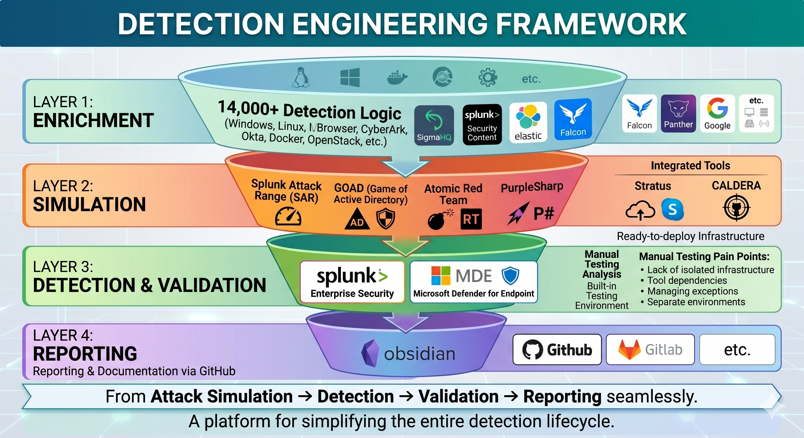
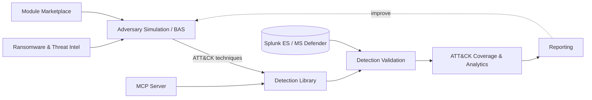

# 🛡️ DetectOps Platform

**An end-to-end Detection Engineering & Adversary Simulation platform, mapped to the MITRE ATT&CK® framework.**

<p align="center">
  
</p>

DetectOps unifies the full purple-team lifecycle — **simulate adversary behavior → detect it → validate coverage → measure and report** — inside a single web application. It brings breach-and-attack simulation, a 14,000+ rule detection catalog, threat intelligence, and AI-assisted detection engineering together so blue and purple teams can go from an ATT&CK technique to a validated, deployable detection without leaving the browser.

<p align="center">
  
  
  
  
  
  
  
</p>

---

## 📑 Table of Contents

- [Overview](#-overview)
- [The Detection Engineering Framework](#-the-detection-engineering-framework)
- [Key Features](#-key-features)
- [Tech Stack](#-tech-stack)
- [Getting Started](#-getting-started)
- [Documentation](#-documentation)
- [Project Structure](#-project-structure)
- [Architecture](#-architecture)
- [Security & Responsible Use](#-security--responsible-use)
- [Contributing](#-contributing)
- [License](#-license)

---

## 📖 Overview

Detection engineering is fragmented across dozens of tools: one for atomic tests, another for Sigma rules, a SIEM for validation, spreadsheets for ATT&CK coverage, and yet another for reporting. **DetectOps collapses that toolchain into one platform.**

Every capability is anchored to **MITRE ATT&CK**, so a single technique ID connects the adversary simulation that exercises it, the detection rules that should fire, the validation run that proves it, and the coverage heatmap that scores it. The result is a closed feedback loop:

> **Emulate** an adversary → **Detect** with rules → **Validate** the detection actually fires → **Measure** coverage → **Report** — then improve and repeat.

---

## 🧭 The Detection Engineering Framework

DetectOps is organized around a four-layer framework that takes you from raw detection logic to a delivered report, seamlessly:

| Layer | Stage | What it does |
|:-----:|-------|--------------|
| **1** | **Enrichment** | 14,000+ detection rules normalized across SigmaHQ, Splunk, Elastic, Falcon, Panther, Google SecOps, and more — covering Windows, Linux, browser, CyberArk, Okta, Docker, OpenStack, and other data sources. |
| **2** | **Simulation** | Ready-to-deploy adversary emulation with Splunk Attack Range (SAR), GOAD (Game of Active Directory), Atomic Red Team, PurpleSharp, Stratus, and CALDERA. |
| **3** | **Detection & Validation** | A built-in testing environment validates detections against Splunk Enterprise Security and Microsoft Defender for Endpoint — removing the manual-testing pain points of isolated infra, tool dependencies, and separate environments. |
| **4** | **Reporting** | Reporting and documentation flows out to Obsidian, GitHub, GitLab, and more. |

> _From **Attack Simulation → Detection → Validation → Reporting**, seamlessly — a platform for simplifying the entire detection lifecycle._

---

## ✨ Key Features

### 🎯 Adversary Simulation & Breach-and-Attack Simulation (BAS)
- **Scenario runner** that executes multi-step attack chains as ATT&CK-mapped `ScenarioStep[]`.
- **Native BAS fleet** powered by a lightweight Rust agent, plus support for BYO C2 (Caldera) and a C2 framework library.
- **Atomic tests catalog** — run individual atomic techniques on-demand and score the resulting detections.
- **Campaign designer** and **emulation orchestrator** for building and sequencing full adversary campaigns.

### 🔍 Detection Content Library (14,000+ Rules)
- A unified catalog spanning **SigmaHQ, Elastic, Splunk, Microsoft Sentinel, Defender, Wazuh, Panther, Falco, MITRE CAR, and Google SecOps**.
- **Continuous sync engine** that pulls the latest community detections (e.g. SigmaHQ) from GitHub.
- Search and pivot by **ATT&CK technique, platform, tactic, vendor, or data source**.

### 🧪 Detection Validation & Coverage
- **Detection validation** ties every simulation run back to the rules that should have fired, scoring true coverage.
- **ATT&CK coverage** views and heatmaps surface blind spots at a glance.
- **Rule workspace** and **SigmaGen** for authoring, editing, and AI-assisted generation of new detections.
- **Per-environment SIEM detection** with encrypted connections and a provider registry (Splunk SPL / Microsoft Defender KQL, bring-your-own-key).

### 🎣 Phishing Simulation (Authorized, Defensive)
- Multi-mode module — **curated training templates**, a **reference tool catalog**, and **AI-generated training lures**.
- **Approval-gated, audited, consent-required**, dummy-data-only, with a global **kill switch**.
- Realistic sandboxed email/landing-page previews; launches map back to ATT&CK phishing techniques for detection scoring.
- 50+ built-in templates across 10+ industry verticals and multiple attack-vector domains.

### 💀 Ransomware Threat Intelligence
- Self-hosted intel collectors tracking **350+ ransomware gangs** and thousands of victims.
- Per-gang **TTPs, IOCs, Sigma/YARA signatures, and leak-site data**.
- One click turns a gang's known TTPs into an **atomic adversary simulation** for detection testing.
- A key-gated public intel API for programmatic access.

### 🧩 Module Marketplace
- **Plugin architecture** where declarative simulation modules compile down to the platform's `ScenarioStep[]` runner.
- Registry, marketplace, visual builder, and **AI validation** for community-contributed content.

### 🔌 MCP Server (Model Context Protocol)
- A production, **streamable-HTTP MCP server** at `/api/mcp` exposing 14k+ detection rules, ~98k IOCs, and ~6.5k threat-intel reports to any MCP client (Claude Desktop, IDEs, agents).
- **API-key auth** with scopes, rate limits, and durable daily quotas — 13 tools for search, lookup, and enrichment.

### 🏗️ Enterprise Environments & Labs
- Integrated **detection lab** with SAR (Splunk Attack Range) + GOAD Active Directory environments for realistic testing.
- **Deploy hub** for Local / Cloud / Fleet labs, deployed from templates onto **your own infrastructure**.
- **Environment manager**, **data lakes**, **CI/CD detection pipelines**, and **PR management** for detection-as-code workflows.

### 📊 Analytics, Reporting & AI
- Dashboards for **analytics, execution logs, and coverage metrics**.
- Automated **reporting** for engagements and coverage posture.
- **Threat modeling**, pluggable **LLM providers**, and AI assistance woven throughout (built on the Anthropic SDK).

---

## 🧱 Tech Stack

| Layer | Technology |
|-------|-----------|
| Framework | Next.js 16 (App Router + Turbopack) |
| UI | React 19, Tailwind CSS 4, MUI, Lucide Icons |
| Charts / Graphs | Recharts, React Flow, Mermaid |
| Database | SQLite via Prisma 7 |
| Language | TypeScript |
| AI | Anthropic SDK, Model Context Protocol SDK |
| Agent | Native Rust BAS agent |
| Labs | Splunk Attack Range, GOAD, Atomic Red Team, CALDERA (deployed via Ansible / Vagrant / Terraform templates) |

---

## 🚀 Getting Started

### Prerequisites
- **Node.js** (LTS) and **npm**
- (Optional, for labs) VirtualBox / a cloud provider account, plus Ansible & Terraform — labs deploy onto **your own** infrastructure
- (Optional) An LLM provider API key (Anthropic, OpenAI, OpenRouter, …) to enable AI features

### Installation

```bash
# 1. Clone
git clone https://github.com/offsec-ttps/DetectOps-Platform.git
cd DetectOps-Platform

# 2. Install dependencies
npm install

# 3. Configure environment (copy the template, then fill in what you need)
cp .env.example .env

# 4. Initialize the local database (schema is created via Prisma migrations)
npx prisma generate
npx prisma migrate deploy

# 5. Start the development server
npm run dev
```

The app runs at **http://localhost:3000**.

> **Note:** the local detection database (`dev.db`) is **not** shipped with the repo. Step 4 creates a fresh one from the Prisma schema; the 14,000+ community detection rules and threat intel are then populated in-app via the **content sync** engine. See [Configuration](docs/getting-started/configuration.md) — the app boots with just `DATABASE_URL`, and every integration is optional and feature-gated.

### Common Scripts

```bash
npm run dev                    # Start the dev server
npm run build                  # Production build
npm run start                  # Run the production server
npm run lint                   # Lint the codebase
npm run cli                    # DetectOps CLI (lab lifecycle: list/create/start/stop/destroy)
npm run seed:offensive-tools   # (Optional) seed the offensive-tools catalog
```

### Docker

Container definitions are provided for the app and the MCP server:

```bash
docker compose up                                 # Full platform
docker compose -f docker-compose.mcp.yml up       # MCP server only
```

---

## 📚 Documentation

Full documentation lives in [`docs/`](docs/) and is built with **MkDocs Material** (`mkdocs serve` for a local site). Start here:

| Topic | Link |
|-------|------|
| 🏠 Docs home | [`docs/index.md`](docs/index.md) |
| 🚀 Getting started | [`docs/getting-started/`](docs/getting-started/index.md) |
| ⚙️ Configuration reference | [`docs/getting-started/configuration.md`](docs/getting-started/configuration.md) |
| 🏗️ Architecture | [`docs/getting-started/architecture.md`](docs/getting-started/architecture.md) |
| 🧭 Platform overview | [`docs/overview.md`](docs/overview.md) |
| 🛠️ Detection engineering | [`docs/engineering/`](docs/engineering/index.md) |
| 🎯 Simulation | [`docs/simulation/`](docs/simulation/index.md) |
| 🔍 Detection | [`docs/detection/`](docs/detection/index.md) |
| 🧪 Labs & Deploy hub | [`docs/labs/deploy-hub.md`](docs/labs/deploy-hub.md) |
| 🔗 SAR + GOAD integration | [`docs/sar-goad-integration/README.md`](docs/sar-goad-integration/README.md) |
| 🔌 MCP server | [`docs/mcp/`](docs/mcp) |
| 📖 Reference | [`docs/reference/`](docs/reference) |

---

## 📂 Project Structure

```
src/
├── app/
│   ├── (dashboard)/      # Main app pages: simulations, detections, validation,
│   │                     #   threat-intel, phishing, marketplace, mcp-registry, ...
│   ├── api/              # API routes (detections, simulations, phishing, mcp, siem, ...)
│   └── (auth)/           # Authentication
├── components/           # Feature UIs (bas, detections, emulation, modules, deploy, ...)
├── lib/                  # Core logic (scenario runner, mcp, modules, phishing, crypto, ...)
├── config/ · data/ · hooks/ · types/
bas-agent/                # Native Rust BAS agent
cli/                      # DetectOps CLI (lab lifecycle over the HTTP API)
cloud-lab-app/            # Cloud lab controller (Astro + Flask)
labs/.blueprints/         # Deployable lab templates (SAR, GOAD, SAR+GOAD)
prisma/                   # Database schema & migrations
docs/                     # Architecture, integration & usage docs (MkDocs)
packs/                    # Detection packs
```

> Deployed lab **instances** (running VMs/state) and local databases stay on your machine and are intentionally **not** committed — the repository ships the **templates** so you can deploy on the infrastructure of your choice.

---

## 🗺️ Architecture

Every module hangs off a shared, ATT&CK-anchored feedback loop. Simulations exercise techniques, the detection library provides the rules, validation confirms they fire, coverage scores the gaps, and reporting closes it out — while threat intel, the module marketplace, and the MCP server feed the loop.



For the full component breakdown, data model, and request lifecycle, see [`docs/getting-started/architecture.md`](docs/getting-started/architecture.md).

---

## 🔐 Security & Responsible Use

DetectOps is built for **authorized, defensive security work** — purple teaming, detection engineering, and blue-team validation. Offensive-leaning capabilities (phishing simulation, adversary emulation) are **approval-gated, audited, consent-required, and shipped with kill switches**. Only use them against systems and people you are explicitly authorized to test.

- Integration secrets (cloud credentials, SIEM/API tokens) are **encrypted at rest** via the credential vault; set `CREDENTIAL_VAULT_KEY` before storing them.
- The lab blueprints ship with **well-known default lab passwords** (e.g. the documented Splunk Attack Range default) for isolated, intentionally-vulnerable environments — **change them** before exposing any lab.
- See the [Security Assessment](SECURITY-ASSESSMENT.md) for the platform's security posture and hardening notes.

---

## 🤝 Contributing

Contributions are welcome — new detection packs, simulation modules, integrations, and docs improvements especially. Please open an issue to discuss substantial changes first, keep secrets out of commits, and follow the existing code style (`npm run lint`).

---

## 📜 License

A formal open-source license has **not been added yet**. Until a `LICENSE` file is present in this repository, please open an issue if you'd like to use, distribute, or build on DetectOps so terms can be clarified.

---

<p align="center"><em>Simulate. Detect. Validate. Measure. — mapped to MITRE ATT&CK®.</em></p>
