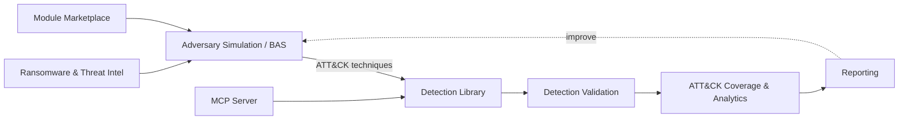

# 🛡️ DetectOps Platform

**An end-to-end Detection Engineering & Adversary Simulation platform, mapped to the MITRE ATT&CK® framework.**

DetectOps unifies the full purple-team lifecycle — **simulate adversary behavior → detect it → validate coverage → measure and report** — inside a single web application. It brings breach-and-attack simulation, a 14,000+ rule detection catalog, threat intelligence, and AI-assisted detection engineering together so blue and purple teams can go from an ATT&CK technique to a validated, deployable detection without leaving the browser.

<p align="left">
  
  
  
  
  
  
</p>

---

## 📖 Overview

Detection engineering is fragmented across dozens of tools: one for atomic tests, another for Sigma rules, a SIEM for validation, spreadsheets for ATT&CK coverage, and yet another for reporting. **DetectOps collapses that toolchain into one platform.**

Every capability is anchored to **MITRE ATT&CK**, so a single technique ID connects the adversary simulation that exercises it, the detection rules that should fire, the validation run that proves it, and the coverage heatmap that scores it. The result is a closed feedback loop:

> **Emulate** an adversary → **Detect** with rules → **Validate** the detection actually fires → **Measure** coverage → **Report** — then improve and repeat.

---

## ✨ Key Features

### 🎯 Adversary Simulation & Breach-and-Attack Simulation (BAS)
- **Scenario runner** that executes multi-step attack chains as ATT&CK-mapped `ScenarioStep[]`.
- **Native BAS fleet** powered by a lightweight Rust agent, plus support for BYO C2 (Caldera) and a C2 framework library.
- **Atomic tests catalog** — run individual atomic techniques on-demand and score the resulting detections.
- **Campaign designer** and **emulation orchestrator** for building and sequencing full adversary campaigns.

### 🔍 Detection Content Library (14,000+ Rules)
- A unified catalog spanning **SigmaHQ, Elastic, Splunk, Microsoft Sentinel, Defender, Wazuh, Panther, Falco, MITRE CAR, and Google SecOps**.
- **Continuous sync engine** that pulls the latest community detections (e.g. SigmaHQ) from GitHub.
- Search and pivot by **ATT&CK technique, platform, tactic, vendor, or data source**.

### 🧪 Detection Validation & Coverage
- **Detection validation** ties every simulation run back to the rules that should have fired, scoring true coverage.
- **ATT&CK coverage** views and heatmaps surface blind spots at a glance.
- **Rule workspace** and **SigmaGen** for authoring, editing, and AI-assisted generation of new detections.

### 🎣 Phishing Simulation (Authorized, Defensive)
- Multi-mode module — **curated training templates**, a **reference tool catalog**, and **AI-generated training lures**.
- **Approval-gated, audited, consent-required**, dummy-data-only, with a global **kill switch**.
- Realistic sandboxed email/landing-page previews; launches map back to ATT&CK phishing techniques for detection scoring.
- 50+ built-in templates across 10+ industry verticals and multiple attack-vector domains.

### 💀 Ransomware Threat Intelligence
- Self-hosted intel collectors tracking **350+ ransomware gangs** and thousands of victims.
- Per-gang **TTPs, IOCs, Sigma/YARA signatures, and leak-site data**.
- One click turns a gang's known TTPs into an **atomic adversary simulation** for detection testing.
- A key-gated public intel API for programmatic access.

### 🧩 Module Marketplace
- **Plugin architecture** where declarative simulation modules compile down to the platform's `ScenarioStep[]` runner.
- Registry, marketplace, visual builder, and **AI validation** for community-contributed content.

### 🔌 MCP Server (Model Context Protocol)
- A production, **streamable-HTTP MCP server** at `/api/mcp` exposing 14k+ detection rules, ~98k IOCs, and ~6.5k threat-intel reports to any MCP client (Claude Desktop, IDEs, agents).
- **API-key auth** with scopes, rate limits, and durable daily quotas — 13 tools for search, lookup, and enrichment.

### 🏗️ Enterprise Environments & Labs
- Integrated **detection lab** with SAR (Splunk Attack Range) + GOAD Active Directory environments for realistic testing.
- **Environment manager**, **data lakes**, **CI/CD detection pipelines**, and **PR management** for detection-as-code workflows.

### 📊 Analytics, Reporting & AI
- Dashboards for **analytics, execution logs, and coverage metrics**.
- Automated **reporting** for engagements and coverage posture.
- **Threat modeling**, pluggable **LLM providers**, and AI assistance woven throughout (built on the Anthropic SDK).

---

## 🧱 Tech Stack

| Layer | Technology |
|-------|-----------|
| Framework | Next.js 16 (App Router + Turbopack) |
| UI | React 19, Tailwind CSS 4, MUI, Lucide Icons |
| Charts / Graphs | Recharts, React Flow, Mermaid |
| Database | SQLite via Prisma 7 |
| Language | TypeScript |
| AI | Anthropic SDK, Model Context Protocol SDK |
| Agent | Native Rust BAS agent |

---

## 🚀 Getting Started

### Prerequisites
- Node.js (LTS) and npm
- A configured `.env` file (copy from `.env.example`)

### Installation

```bash
# Install dependencies
npm install

# Set up your environment
cp .env.example .env

# Run the development server
npm run dev
```

The app runs at **http://localhost:3000**.

### Common Scripts

```bash
npm run dev      # Start the dev server
npm run build    # Production build
npm run start    # Run the production server
npm run lint     # Lint the codebase
```

---

## 📂 Project Structure

```
src/
├── app/
│   ├── (dashboard)/      # Main app pages: simulations, detections, validation,
│   │                     #   threat-intel, phishing, marketplace, mcp-registry, ...
│   ├── api/              # API routes (detections, simulations, phishing, mcp, ...)
│   └── (auth)/           # Authentication
├── components/           # Feature UIs (bas, detections, emulation, modules, ...)
├── lib/                  # Core logic (scenario runner, mcp, modules, phishing, ...)
├── config/ · data/ · hooks/ · types/
bas-agent/                # Native Rust BAS agent
prisma/                   # Database schema
docs/                     # Architecture & integration docs
```

---

## 🗺️ How It Fits Together



---

## ⚖️ Responsible Use

DetectOps is built for **authorized, defensive security work** — purple teaming, detection engineering, and blue-team validation. Offensive-leaning capabilities (phishing simulation, adversary emulation) are approval-gated, audited, consent-required, and shipped with kill switches. Only use them against systems and people you are explicitly authorized to test.

---

<p align="center"><em>Simulate. Detect. Validate. Measure. — mapped to MITRE ATT&CK®.</em></p>
