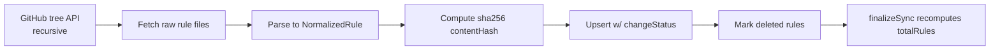

# Community Content — 14,000+ Detection Rules

**Route:** `/community` · **Sidebar:** Engineering → Community Content

A single browse-and-search surface over many open detection-rule corpora. The shipped database contains **14,000+ unified detection rules** (the count is computed live at sync time, not hardcoded — see [Counts are live](#counts-are-live)).

## Sources

Two layers are merged in the UI:

- **Legacy sources** (own dedicated tables and detail pages): **SigmaHQ, Elastic, Splunk (ESCU)**.
- **Unified adapters** (write into the shared `community_rules` table): **MITRE CAR, Microsoft Sentinel, Defender XDR, Google SecOps, Panther, Falco, Wazuh**.

Adapters live in `src/lib/community-sources/adapters/` and implement `ICommunitySourceAdapter` (`meta()` + `sync()`, optional `status()`/`check()`). Rule languages span `sigma`, `spl`, `kql`, `eql`, `lucene`, `esql`, `yara-l`, `python`, `falco-yaml`, `wazuh-xml`, `toml`, and more.

## Data model

- `CommunitySource` — per-source metadata: `totalRules`, `importedRulesCount`, `lastSyncAt`.
- `CommunityRule` (the normalized rule): ATT&CK arrays (`mitreTechniques` / `mitreTactics`), targeting (`platforms` / `products` / `logSources` / `tags`), content (`ruleLanguage` / `ruleType` / `detectionLogicRaw` / `conversionSupported`), maturity, provenance (`sourceFilePath` / `sourceUrl` / `rawPayload`), a `contentHash`, and a `changeStatus` (`new` / `modified` / `deleted` / `unchanged`). List fields are JSON strings (SQLite).
- `SigmaConversion` — tracks pySigma / Sigma-CLI conversion attempts.

## Ingestion & normalization

Each adapter follows the same flow (helpers in `adapters/_common.ts`):

1. `fetchRepoTree()` pulls the repo tree (retry + optional `GITHUB_TOKEN`).
2. Files are fetched in batches, parsed to `NormalizedRule`.
3. ATT&CK IDs are extracted by regex (`T\d{4}(\.\d{3})?` / `TA\d{4}`).
4. `upsertNormalizedRule()` computes a 16-char sha256 `contentHash` for change detection.
5. `markDeletedRules()` flags rows whose upstream path disappeared (history preserved).
6. `finalizeSync()` recomputes `totalRules = count(changeStatus != deleted)`.

### Counts are live

`CommunitySource.totalRules` is recomputed after each sync — the "14,000+" headline reflects the actual database state, not a constant. (The only literal marketing figure lives in `src/components/marketing/LandingClient.tsx`.)

## Search

`POST /api/community/unified/search` (`buildSearchResponse`) filters out deleted rules, applies DB-level filters (query, severity, rule language, rule type), then in-JS filters JSON arrays (platform / technique / tactic), paginates (max 100/page), and caches responses for ~30s. It returns a `sources` facet so you can pivot by source. Legacy sources keep their own `/api/community/{sigmahq,elastic,splunk}/rules` routes; the page combines both.

## Enabling & refreshing

- **Feature flags** (`src/lib/community-sources/flags.ts`): master `ENABLE_COMMUNITY_CONTENT_EXPANSION` plus per-source `ENABLE_*_SOURCE` (all default on). `isSourceEnabled()` gates each.
- **Refresh all**: `POST /api/community/refresh-all` runs enabled adapters with bounded concurrency, skips legacy unless `?includeLegacy=true`, invalidates the cache, and writes an audit entry. Intended to be triggered by cron/CI.
- **Per-source sync**: `POST /api/community/unified/[slug]/sync`.

## Using it

Open `/community` → use the search box, source dropdown, and ATT&CK / platform / severity filters → results merge legacy and unified rules → click through to a rule detail (`/community/{slug}/{id}`). Sigma rules marked `conversionSupported` can be converted to your SIEM backend in the [Rule Workspace](../engineering/rule-workspace.md).

## APIs

`/api/community/`: `registry`, `health`, `refresh-all`, `unified/search`, `unified/compare`, `unified/[slug]/{rules,summary,sync}`, and per-legacy-source `{sigmahq,elastic,splunk,mitre-car}/{sync,rules,summary}`.
