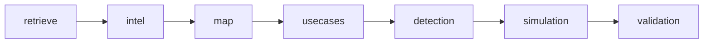

# SigmaGen AI (SigmaAI Builder)

**Route:** `/sigmagen` · **Sidebar:** Engineering → SigmaGen AI

SigmaGen AI is a chat-driven, **multi-agent pipeline** that turns arbitrary threat intel — a URL, PDF, DOCX, pasted text, or raw IOCs — into a complete detection bundle: a structured intel profile, ATT&CK mapping, use cases, **Sigma-first detection rules + an IR playbook**, adversary simulations, and rule validation.

## The pipeline

`src/lib/sigmagen/pipeline.ts` (`runSigmaGenPipeline`) runs seven steps, streaming progress into `SigmaGenRun.steps` for the UI to poll:

1. **retrieve** — follow references, pull related RSS, optional web search.
2. **intel** — extract a structured profile (summary, attack profile, actor, CVEs, timeline, IOCs, mitigations, candidate techniques, references). IOCs are refanged; attribution is never fabricated.
3. **map** — validated ATT&CK technique/tactic list (regex-gated), data sources, detection opportunities.
4. **usecases** — multi-scenario use cases persisted as `UseCase` rows (with atomic steps).
5. **detection** — reuses `generateDetectionPack()` to produce Sigma-first rules + an IR playbook ([Detection Pack](../detection/detection-packs.md)).
6. **simulation** — catalog match (`inferSimulations`: ART / PurpleSharp / Stratus) with an LLM fallback for uncovered techniques.
7. **validation** — converts each Sigma rule via pySigma / the Sigma CLI, setting `validationStatus` (converted / invalid / unvalidated); degrades gracefully if the CLI isn't installed.

## Inputs & guardrails

- **Inputs**: URL, PDF, DOCX, plain text, or raw IOCs (`src/lib/sigmagen/ingest/`). URL fetches are **SSRF-guarded**.
- **Guardrails** (`src/lib/sigmagen/guardrails.ts`): the ingested text is scanned for prompt-injection/jailbreak, invisible characters stripped, wrapped as untrusted input, and every agent's system prompt carries a guardrail clause. It does not hard-block (legitimate intel quotes attacker tradecraft) but records a guardrail report.

## LLM providers

Runs on the multi-provider backbone (`src/lib/llm/providers/`: Anthropic, OpenAI, OpenRouter, NVIDIA, Ollama). Default resolves via `smartDefaultProvider()` — honors `LLM_PROVIDER_DEFAULT`, else priority Anthropic → OpenAI → OpenRouter → NVIDIA → Ollama. Keys are managed under [Settings → LLM Providers](../system/settings.md). Runs are token-budget-guarded (`DETECTION_PACK_DAILY_TOKEN_BUDGET`).

## Outputs

Everything links back on the `SigmaGenRun` and shows in the run artifacts panel: the attack mapping, use cases, a detection pack (Sigma rules + IR playbook), simulations, and validated rules. Every LLM call also writes an `AiGeneration` record for cost/token accounting.

## Using it

Open `/sigmagen` → start a session → paste a URL, drop a PDF/DOCX, or paste text/IOCs (optionally pick a provider and toggle retrieval) → watch the 7-step agent timeline update → review the extracted intel, techniques, generated use cases, Sigma rules + IR playbook, and simulations.

## APIs

`/api/sigmagen/`: `sessions` (+ `/[id]`, `/[id]/run`), `ingest`, `convert`, `runs/[id]` (progress polling). A run is started with `POST /api/sigmagen/sessions/[id]/run` (auth + IDOR guard, multipart ≤12 MB or JSON, SSRF check, provider-readiness check, budget guard) which returns `202 {runId}`; the client polls `runs/[id]`.
