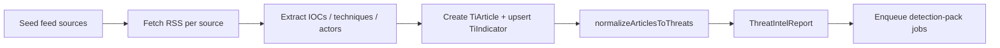

# Threat Aggregator (Threat Intel Ingestion)

**Route:** `/threat-intel` · **Sidebar:** Engineering → Threat Intel Ingestion

The Threat Aggregator ingests threat-intel from **~185 RSS/blog feeds**, extracts IOCs, ATT&CK techniques, and threat actors, and normalizes everything into unified threat reports that feed detection-pack and playbook generation.

## Feeds

`src/lib/threat-intel/feed-config.ts` defines ~185 sources across categories: independent researchers, CERTs/government (CISA, NCSC, CERT-EU, CERT-FR, CERT.PL, JPCERT, Canadian Cyber Centre), security media (BleepingComputer, The Hacker News, Dark Reading, The Record, WIRED), and vendors (CrowdStrike, Microsoft, Unit 42, Talos, Mandiant, Recorded Future, Elastic Security Labs, Red Canary, Wiz, Sysdig). Each entry carries name / blog URL / feed URL / category / type (`rss` | `blog` | `api`).

## Data model

- `TiFeedSource` — a feed: name, category, `blogUrl` / `feedUrl`, `active`, `lastFetchedAt` / `lastError`, `articleCount`, `indicatorCount`.
- `TiArticle` — an ingested article: title, URL, author, `publishedAt`, `rawContent` (≤100 KB), summary, tags, `iocCount`, `processed`, `contentHash`.
- `TiIndicator` — an IOC: type (`ipv4`/`domain`/`url`/`hash`/`email`/`cve`/`registry`/`filename`…), value, context, confidence, `tlp`, first/last seen, `sightings`, `mitreTechniques`, `sourceRef`. Unique `[type, value]` (dedup with a sighting increment).
- `ThreatIntelReport` — the normalized unified threat consumed downstream.

## Ingestion flow

`src/lib/threat-intel/aggregator.ts` (`runAggregatorSync`):

1. `seedFeedSources()` upserts the feed list into `TiFeedSource`.
2. Each active RSS source is fetched (concurrency-limited; ≤50 articles/source; existing URLs skipped).
3. `src/lib/threat-intel/ioc-extractor.ts` extracts IOCs (with refang of `hxxp` / `[.]`, private-IP filtering), ATT&CK techniques (`T####[.###]`), and threat actors (matched against a `KNOWN_ACTORS` list — APT28/29/41, Lazarus, LockBit, Volt Typhoon, Scattered Spider…).
4. Articles and indicators are persisted (indicators dedup with a sighting increment).
5. `normalizeArticlesToThreats()` converts articles-with-IOCs into `ThreatIntelReport` rows (heuristic severity/category → APT / RANSOMWARE / SUPPLY_CHAIN / PHISHING / ZERO_DAY, CVSS derived from severity).
6. New reports are enqueued for [Detection Pack](../detection/detection-packs.md) generation (idempotent).

## Mapping to techniques & playbooks

- **Techniques** — extracted by regex at ingest and refined by [SigmaGen AI](sigmagen-ai.md)'s attack-mapping step.
- **Playbooks** — a report can be turned into a playbook/use-case via `src/lib/llm/generators/ti-to-playbook.ts` (`GeneratePlaybookButton`): it loads the report, builds context, calls the LLM for each deliverable, and persists a `UseCase` (atomic/purplesharp/manual steps) + a `Playbook`.

## Using it

Open `/threat-intel` → review the feed of articles/reports with severity/category filters and an indicators view → check source status → **Sync** to pull all RSS feeds → generate a playbook/use-case from any report.

## APIs

`/api/threat-intel/`: base list (+ `/[id]`), `stats`, `indicators`, `sources`, `vendors`, `sync` (POST → `runAggregatorSync`).
