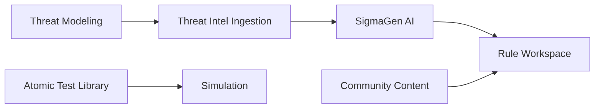

# Engineering

**Sidebar section:** Engineering

The Engineering section is where you model threats and author, generate, and browse detection content. It maps to the dashboard's **Engineering** menu.

## In this section

| Subsection | Route | What it does |
|-----------|-------|--------------|
| [Threat Modeling](threat-modeling.md) | `/threat-modeling` | Build threat models and map them to MITRE ATT&CK. |
| [Threat Intel Ingestion](../content/threat-aggregator.md) | `/threat-intel` | Aggregate ~185 intel feeds; extract IOCs, techniques, and actors. |
| [SigmaGen AI](../content/sigmagen-ai.md) | `/sigmagen` | AI pipeline: intel → ATT&CK map → Sigma rules + IR playbook + sims. |
| [Rule Workspace](rule-workspace.md) | `/rule-workspace` | Edit Sigma rules, convert to SIEM backends, open PRs. |
| [Atomic Test Library](../content/atomic-test-library.md) | `/atomic-tests` | Browse ~2,000 Atomic Red Team tests; author custom tests. |
| [Community Content](../content/community-content.md) | `/community` | Search 14,000+ community detection rules across many sources. |
| [Custom Modules](custom-modules.md) | `/marketplace/build` | Create, validate, and deploy your own attack-simulation modules. |
| [Attack Simulation Test Report](attack-simulation-test-report.md) | — | Build & end-to-end test results for the Attack Simulation libraries. |

## Typical flow

