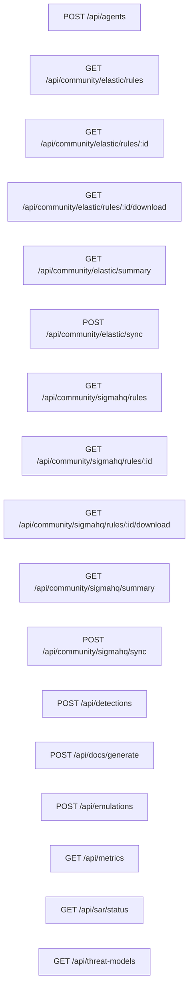

# API Reference

> Auto-generated by docs-agent on 3/29/2026, 6:04:32 AM

## Endpoints Summary

| Method | Route | Description | File |
|--------|-------|-------------|------|
| `GET` | `/api/agents` | List/Get agents | `src/app/api/agents/route.ts` |
| `POST` | `/api/agents` | Create/Trigger agents | `src/app/api/agents/route.ts` |
| `GET` | `/api/community/elastic/rules` | List/Get rules | `src/app/api/community/elastic/rules/route.ts` |
| `GET` | `/api/community/elastic/rules/:id` | List/Get :id | `src/app/api/community/elastic/rules/[id]/route.ts` |
| `GET` | `/api/community/elastic/rules/:id/download` | List/Get download | `src/app/api/community/elastic/rules/[id]/download/route.ts` |
| `GET` | `/api/community/elastic/summary` | List/Get summary | `src/app/api/community/elastic/summary/route.ts` |
| `POST` | `/api/community/elastic/sync` | Create/Trigger sync | `src/app/api/community/elastic/sync/route.ts` |
| `GET` | `/api/community/sigmahq/rules` | List/Get rules | `src/app/api/community/sigmahq/rules/route.ts` |
| `GET` | `/api/community/sigmahq/rules/:id` | List/Get :id | `src/app/api/community/sigmahq/rules/[id]/route.ts` |
| `GET` | `/api/community/sigmahq/rules/:id/download` | List/Get download | `src/app/api/community/sigmahq/rules/[id]/download/route.ts` |
| `GET` | `/api/community/sigmahq/summary` | List/Get summary | `src/app/api/community/sigmahq/summary/route.ts` |
| `POST` | `/api/community/sigmahq/sync` | Create/Trigger sync | `src/app/api/community/sigmahq/sync/route.ts` |
| `GET` | `/api/detections` | List/Get detections | `src/app/api/detections/route.ts` |
| `POST` | `/api/detections` | Create/Trigger detections | `src/app/api/detections/route.ts` |
| `GET` | `/api/docs/generate` | List/Get generate | `src/app/api/docs/generate/route.ts` |
| `POST` | `/api/docs/generate` | Create/Trigger generate | `src/app/api/docs/generate/route.ts` |
| `GET` | `/api/emulations` | List/Get emulations | `src/app/api/emulations/route.ts` |
| `POST` | `/api/emulations` | Create/Trigger emulations | `src/app/api/emulations/route.ts` |
| `GET` | `/api/metrics` | List/Get metrics | `src/app/api/metrics/route.ts` |
| `GET` | `/api/sar/status` | ── Route handler ── | `src/app/api/sar/status/route.ts` |
| `GET` | `/api/threat-models` | List/Get threat-models | `src/app/api/threat-models/route.ts` |

## Endpoint Details

### /api/agents

#### `GET /api/agents`

- **File:** `src/app/api/agents/route.ts`
- **Description:** List/Get agents

#### `POST /api/agents`

- **File:** `src/app/api/agents/route.ts`
- **Description:** Create/Trigger agents

### /api/community/elastic

#### `GET /api/community/elastic/rules`

- **File:** `src/app/api/community/elastic/rules/route.ts`
- **Description:** List/Get rules
- **Query Parameters:**
  - `page`
  - `page_size`
  - `text_search`
  - `severity`
  - `type`
  - `platform`
  - `mitre_technique`
  - `change_status`
  - `sort_by`
  - `sort_dir`

#### `GET /api/community/elastic/rules/:id`

- **File:** `src/app/api/community/elastic/rules/[id]/route.ts`
- **Description:** List/Get :id

#### `GET /api/community/elastic/rules/:id/download`

- **File:** `src/app/api/community/elastic/rules/[id]/download/route.ts`
- **Description:** List/Get download

#### `GET /api/community/elastic/summary`

- **File:** `src/app/api/community/elastic/summary/route.ts`
- **Description:** List/Get summary

#### `POST /api/community/elastic/sync`

- **File:** `src/app/api/community/elastic/sync/route.ts`
- **Description:** Create/Trigger sync

### /api/community/sigmahq

#### `GET /api/community/sigmahq/rules`

- **File:** `src/app/api/community/sigmahq/rules/route.ts`
- **Description:** List/Get rules
- **Query Parameters:**
  - `page`
  - `page_size`
  - `text_search`
  - `status`
  - `level`
  - `tag`
  - `mitre_technique`
  - `logsource_product`
  - `change_status`
  - `sort_by`
  - `sort_dir`

#### `GET /api/community/sigmahq/rules/:id`

- **File:** `src/app/api/community/sigmahq/rules/[id]/route.ts`
- **Description:** List/Get :id

#### `GET /api/community/sigmahq/rules/:id/download`

- **File:** `src/app/api/community/sigmahq/rules/[id]/download/route.ts`
- **Description:** List/Get download

#### `GET /api/community/sigmahq/summary`

- **File:** `src/app/api/community/sigmahq/summary/route.ts`
- **Description:** List/Get summary

#### `POST /api/community/sigmahq/sync`

- **File:** `src/app/api/community/sigmahq/sync/route.ts`
- **Description:** Create/Trigger sync

### /api/detections

#### `GET /api/detections`

- **File:** `src/app/api/detections/route.ts`
- **Description:** List/Get detections

#### `POST /api/detections`

- **File:** `src/app/api/detections/route.ts`
- **Description:** Create/Trigger detections

### /api/docs/generate

#### `GET /api/docs/generate`

- **File:** `src/app/api/docs/generate/route.ts`
- **Description:** List/Get generate

#### `POST /api/docs/generate`

- **File:** `src/app/api/docs/generate/route.ts`
- **Description:** Create/Trigger generate

### /api/emulations

#### `GET /api/emulations`

- **File:** `src/app/api/emulations/route.ts`
- **Description:** List/Get emulations

#### `POST /api/emulations`

- **File:** `src/app/api/emulations/route.ts`
- **Description:** Create/Trigger emulations

### /api/metrics

#### `GET /api/metrics`

- **File:** `src/app/api/metrics/route.ts`
- **Description:** List/Get metrics

### /api/sar/status

#### `GET /api/sar/status`

- **File:** `src/app/api/sar/status/route.ts`
- **Description:** ── Route handler ──

### /api/threat-models

#### `GET /api/threat-models`

- **File:** `src/app/api/threat-models/route.ts`
- **Description:** List/Get threat-models

## API Connectivity

