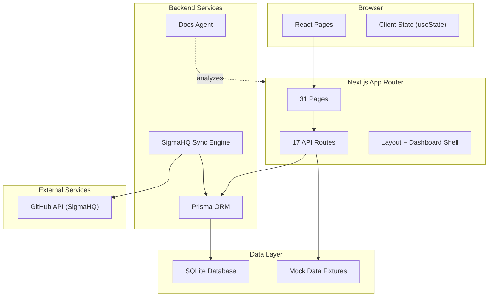
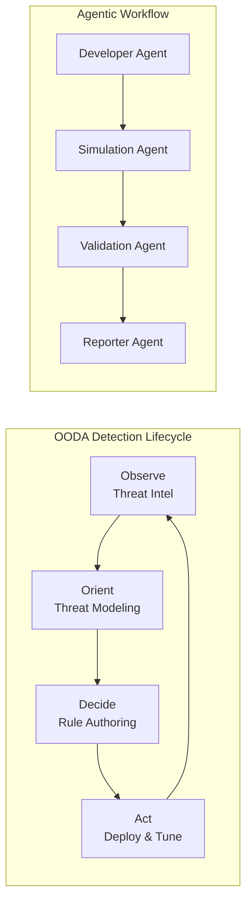

# Architecture Overview

> Auto-generated by docs-agent on 3/29/2026, 6:04:32 AM

## Stack

| Layer | Technology |
|-------|-----------|
| Framework | Next.js 16 (App Router + Turbopack) |
| UI | React 19, Tailwind CSS 4, Lucide Icons |
| Charts | Recharts |
| Database | SQLite via Prisma 7 |
| Language | TypeScript |

## Project Stats

| Metric | Count |
|--------|-------|
| Pages | 31 |
| API Endpoints | 21 |
| Components | 12 |
| Type Definitions | 68 |
| Dependencies | 28 |

## High-Level Architecture

## Application Flow

