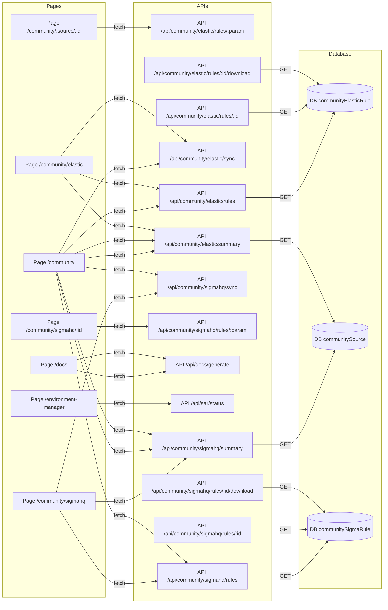

# Data Flow Diagram

> Auto-generated by docs-agent on 3/29/2026, 6:04:32 AM

## Page → API → Database Flows

## All Data Flows

| From | To | Label |
|------|----|---------|
| API /api/community/elastic/rules/:id/download | DB communityElasticRule | GET |
| API /api/community/elastic/rules/:id | DB communityElasticRule | GET |
| API /api/community/elastic/rules | DB communityElasticRule | GET |
| API /api/community/elastic/summary | DB communitySource | GET |
| API /api/community/sigmahq/rules/:id/download | DB communitySigmaRule | GET |
| API /api/community/sigmahq/rules/:id | DB communitySigmaRule | GET |
| API /api/community/sigmahq/rules | DB communitySigmaRule | GET |
| API /api/community/sigmahq/summary | DB communitySource | GET |
| Page /community/:source/:id | API /api/community/elastic/rules/:param | fetch |
| Page /community/elastic | API /api/community/elastic/summary | fetch |
| Page /community/elastic | API /api/community/elastic/rules | fetch |
| Page /community/elastic | API /api/community/elastic/sync | fetch |
| Page /community | API /api/community/sigmahq/summary | fetch |
| Page /community | API /api/community/elastic/summary | fetch |
| Page /community | API /api/community/sigmahq/rules | fetch |
| Page /community | API /api/community/elastic/rules | fetch |
| Page /community | API /api/community/sigmahq/sync | fetch |
| Page /community | API /api/community/elastic/sync | fetch |
| Page /community | API /api/community/sigmahq/summary | fetch |
| Page /community | API /api/community/elastic/summary | fetch |
| Page /community/sigmahq/:id | API /api/community/sigmahq/rules/:param | fetch |
| Page /community/sigmahq | API /api/community/sigmahq/summary | fetch |
| Page /community/sigmahq | API /api/community/sigmahq/rules | fetch |
| Page /community/sigmahq | API /api/community/sigmahq/sync | fetch |
| Page /docs | API /api/docs/generate | fetch |
| Page /docs | API /api/docs/generate | fetch |
| Page /environment-manager | API /api/sar/status | fetch |
