# Routes Map

> Auto-generated by docs-agent on 3/29/2026, 6:04:32 AM

## Pages (31)

| Route | File | Dynamic | Params |
|-------|------|---------|--------|
| `/` | `src/app/page.tsx` | No | — |
| `/agentic-sync` | `src/app/(dashboard)/agentic-sync/page.tsx` | No | — |
| `/agents` | `src/app/(dashboard)/agents/page.tsx` | No | — |
| `/analytics` | `src/app/(dashboard)/analytics/page.tsx` | No | — |
| `/atomic-tests` | `src/app/(dashboard)/atomic-tests/page.tsx` | No | — |
| `/campaign-designer` | `src/app/(dashboard)/campaign-designer/page.tsx` | No | — |
| `/cicd` | `src/app/(dashboard)/cicd/page.tsx` | No | — |
| `/community` | `src/app/(dashboard)/community/page.tsx` | No | — |
| `/community/:source/:id` | `src/app/(dashboard)/community/[source]/[id]/page.tsx` | Yes | source, id |
| `/community/elastic` | `src/app/(dashboard)/community/elastic/page.tsx` | No | — |
| `/community/sigmahq` | `src/app/(dashboard)/community/sigmahq/page.tsx` | No | — |
| `/community/sigmahq/:id` | `src/app/(dashboard)/community/sigmahq/[id]/page.tsx` | Yes | id |
| `/data-lakes` | `src/app/(dashboard)/data-lakes/page.tsx` | No | — |
| `/detection-validation` | `src/app/(dashboard)/detection-validation/page.tsx` | No | — |
| `/detections` | `src/app/(dashboard)/detections/page.tsx` | No | — |
| `/detections/:id` | `src/app/(dashboard)/detections/[id]/page.tsx` | Yes | id |
| `/docs` | `src/app/(dashboard)/docs/page.tsx` | No | — |
| `/emulation` | `src/app/(dashboard)/emulation/page.tsx` | No | — |
| `/environment-manager` | `src/app/(dashboard)/environment-manager/page.tsx` | No | — |
| `/execution-logs` | `src/app/(dashboard)/execution-logs/page.tsx` | No | — |
| `/mcp-registry` | `src/app/(dashboard)/mcp-registry/page.tsx` | No | — |
| `/orchestrator` | `src/app/(dashboard)/orchestrator/page.tsx` | No | — |
| `/overview` | `src/app/(dashboard)/overview/page.tsx` | No | — |
| `/pipelines` | `src/app/(dashboard)/pipelines/page.tsx` | No | — |
| `/pr-management` | `src/app/(dashboard)/pr-management/page.tsx` | No | — |
| `/reporting` | `src/app/(dashboard)/reporting/page.tsx` | No | — |
| `/rule-workspace` | `src/app/(dashboard)/rule-workspace/page.tsx` | No | — |
| `/settings` | `src/app/(dashboard)/settings/page.tsx` | No | — |
| `/sigmagen` | `src/app/(dashboard)/sigmagen/page.tsx` | No | — |
| `/threat-intel` | `src/app/(dashboard)/threat-intel/page.tsx` | No | — |
| `/threat-modeling` | `src/app/(dashboard)/threat-modeling/page.tsx` | No | — |

## API Routes (17)

| Route | Methods | File | Dynamic |
|-------|---------|------|---------|
| `/api/agents` | `GET`, `POST` | `src/app/api/agents/route.ts` | No |
| `/api/community/elastic/rules` | `GET` | `src/app/api/community/elastic/rules/route.ts` | No |
| `/api/community/elastic/rules/:id` | `GET` | `src/app/api/community/elastic/rules/[id]/route.ts` | Yes |
| `/api/community/elastic/rules/:id/download` | `GET` | `src/app/api/community/elastic/rules/[id]/download/route.ts` | Yes |
| `/api/community/elastic/summary` | `GET` | `src/app/api/community/elastic/summary/route.ts` | No |
| `/api/community/elastic/sync` | `POST` | `src/app/api/community/elastic/sync/route.ts` | No |
| `/api/community/sigmahq/rules` | `GET` | `src/app/api/community/sigmahq/rules/route.ts` | No |
| `/api/community/sigmahq/rules/:id` | `GET` | `src/app/api/community/sigmahq/rules/[id]/route.ts` | Yes |
| `/api/community/sigmahq/rules/:id/download` | `GET` | `src/app/api/community/sigmahq/rules/[id]/download/route.ts` | Yes |
| `/api/community/sigmahq/summary` | `GET` | `src/app/api/community/sigmahq/summary/route.ts` | No |
| `/api/community/sigmahq/sync` | `POST` | `src/app/api/community/sigmahq/sync/route.ts` | No |
| `/api/detections` | `GET`, `POST` | `src/app/api/detections/route.ts` | No |
| `/api/docs/generate` | `GET`, `POST` | `src/app/api/docs/generate/route.ts` | No |
| `/api/emulations` | `GET`, `POST` | `src/app/api/emulations/route.ts` | No |
| `/api/metrics` | `GET` | `src/app/api/metrics/route.ts` | No |
| `/api/sar/status` | `GET` | `src/app/api/sar/status/route.ts` | No |
| `/api/threat-models` | `GET` | `src/app/api/threat-models/route.ts` | No |

## Layouts (2)

- `src/app/(dashboard)/layout.tsx`
- `src/app/layout.tsx`

## Route Tree

```mermaid
graph TD
    root["/"]
    p_agentic-sync["/agentic-sync"]
    root --> p_agentic-sync
    p_agents["/agents"]
    root --> p_agents
    p_analytics["/analytics"]
    root --> p_analytics
    p_atomic-tests["/atomic-tests"]
    root --> p_atomic-tests
    p_campaign-designer["/campaign-designer"]
    root --> p_campaign-designer
    p_cicd["/cicd"]
    root --> p_cicd
    p_community["/community"]
    root --> p_community
    p_community_source["/[:source]"]
    p_community --> p_community_source
    p_community_source_id["/[:id]"]
    p_community_source --> p_community_source_id
    p_community_elastic["/elastic"]
    p_community --> p_community_elastic
    p_community_sigmahq["/sigmahq"]
    p_community --> p_community_sigmahq
    p_community_sigmahq_id["/[:id]"]
    p_community_sigmahq --> p_community_sigmahq_id
    p_data-lakes["/data-lakes"]
    root --> p_data-lakes
    p_detection-validation["/detection-validation"]
    root --> p_detection-validation
    p_detections["/detections"]
    root --> p_detections
    p_detections_id["/[:id]"]
    p_detections --> p_detections_id
    p_docs["/docs"]
    root --> p_docs
    p_emulation["/emulation"]
    root --> p_emulation
    p_environment-manager["/environment-manager"]
    root --> p_environment-manager
    p_execution-logs["/execution-logs"]
    root --> p_execution-logs
    p_mcp-registry["/mcp-registry"]
    root --> p_mcp-registry
    p_orchestrator["/orchestrator"]
    root --> p_orchestrator
    p_overview["/overview"]
    root --> p_overview
    p_pipelines["/pipelines"]
    root --> p_pipelines
    p_pr-management["/pr-management"]
    root --> p_pr-management
    p_reporting["/reporting"]
    root --> p_reporting
    p_rule-workspace["/rule-workspace"]
    root --> p_rule-workspace
    p_settings["/settings"]
    root --> p_settings
    p_sigmagen["/sigmagen"]
    root --> p_sigmagen
    p_threat-intel["/threat-intel"]
    root --> p_threat-intel
    p_threat-modeling["/threat-modeling"]
    root --> p_threat-modeling
```

