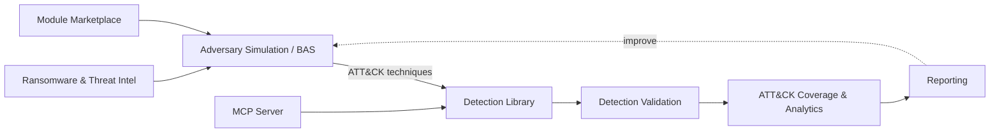
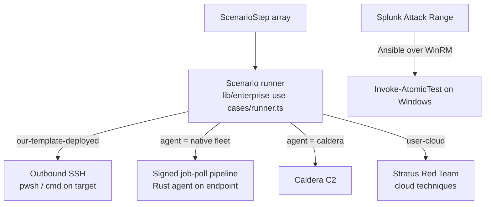

# Architecture

DetectOps is a single **Next.js 16** application (App Router) with API routes, a **SQLite/Prisma 7** data layer, a **native Rust BAS agent** for on-endpoint execution, and an optional **FastAPI backend** ("SentinelFlow") for auxiliary services. AI features run through a pluggable multi-provider LLM backbone.

## High-level flow



## How a simulation reaches a target

The platform never assumes the controller and targets share an OS. Execution transport is chosen per environment:



- **SSH** — for template-deployed lab VMs (Windows OpenSSH or Linux).
- **Native fleet agent** — a Rust agent installed on the endpoint pulls signed, hash-pinned jobs (`/api/v1/*`), runs them locally, and reports back. No inbound ports on the endpoint.
- **Caldera / Stratus** — bring-your-own C2 and cloud-native detonation.
- **Splunk Attack Range** — uses Ansible over WinRM to run `Invoke-AtomicTest` on Windows hosts.

See [Enterprise Use-Case Validation](../simulation/enterprise-use-cases.md) and [Fleet Server](../labs/fleet-server.md) for details.

## Data model

The Prisma schema (`prisma/schema.prisma`) defines ~82 models. Everything is anchored to MITRE ATT&CK technique IDs, and list/array fields are stored as JSON strings (SQLite). Ingested content (community rules, threat intel) and AI-generated content (SigmaGen, detection packs) converge on the same downstream models — `DetectionPack`, `UseCase`, `Playbook`.

## Auto-generated reference

The in-app **docs-agent** (`src/lib/docs-agent/`, run via `npm run docs:generate` and on `postbuild`) emits a machine-generated reference into `docs/generated/`:

- `architecture.md`, `service-map.md`, `data-flows.md`
- `api-reference.md`, `routes-map.md`
- `components.md`, `types.md`, `dependencies.md`

These are included in the [API Reference](../reference/api.md) tab. They regenerate on every build, so treat them as living reference rather than hand-edited pages.

## Repository layout

```
src/
├── app/
│   ├── (dashboard)/      # Main app pages (sidebar sections)
│   ├── api/              # API routes
│   └── (auth)/           # Authentication
├── components/           # Feature UIs
├── lib/                  # Core logic (runner, mcp, modules, sigmagen, ...)
├── config/ · data/ · hooks/ · types/
bas-agent/                # Native Rust BAS agent
backend/                  # FastAPI "SentinelFlow" service + Sigma CLI venv
prisma/                   # Database schema + migrations
scripts/                  # Lab lifecycle + seeders
docs/                     # This documentation site
packs/                    # File-based content packs (e.g. phishing templates)
```
