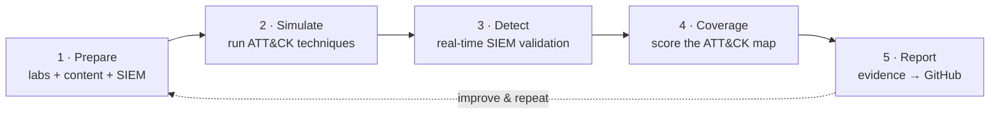

# DetectOps Platform

**An end-to-end Detection Engineering & Adversary Simulation platform, mapped to the MITRE ATT&CK® framework.**

DetectOps unifies the full purple-team lifecycle inside a single web app: **Prepare → Simulate → Detect → Coverage → Report.** It brings breach-and-attack simulation, a 14,000+ rule detection catalog, threat intelligence, real-time SIEM validation, and AI-assisted detection engineering together so blue and purple teams can go from an ATT&CK technique to a *validated, deployable* detection without leaving the browser.

!!! tip "New here? Start with the three-step path"
    1. [Prerequisites](getting-started/prerequisites.md) — what the host needs.
    2. [Installation](getting-started/installation.md) — get the app running at `http://localhost:3000`.
    3. [Deploy Hub](labs/deploy-hub.md) — stand up a lab and run your first simulation.

## The DetectOps loop

Every capability is anchored to **MITRE ATT&CK**, so one technique ID connects the lab you attack, the simulation that exercises it, the rule that should fire, the coverage it scores, and the report you ship. Follow it in five stages:

| Stage | You do this… | …with these |
|-------|--------------|-------------|
| **1 · Prepare** | Stand up a lab, load content, wire a SIEM | Deploy Hub · Detection Lab · Atomic/Rule/Intel content |
| **2 · Simulate** | Run adversary techniques where they matter | Campaign Designer · Fleet C2 · Simulation modules |
| **3 · Detect** | Prove the alert actually fires — in real time | SIEM Integration (Splunk / MDE) · Detection Validation |
| **4 · Coverage** | Score what's covered vs. what's blind | ATT&CK coverage · Analytics |
| **5 · Report** | Turn evidence into detection-as-code | Reporting · PR Management · CI/CD |

---

## 1 · Prepare

Stand up somewhere to attack, load the detection content, and connect a SIEM to score against.

| Feature | What it does | Docs |
|---------|--------------|------|
| **Deploy Hub** | One chooser for **Local**, **Cloud**, and **Fleet** targets | [Deploy Hub](labs/deploy-hub.md) |
| **Local Lab** | SAR + GOAD on VirtualBox/Vagrant, under the project path | [Local Lab](labs/local-lab.md) |
| **Cloud Lab** | SAR (± GOAD) into **your** AWS/Azure/GCP via the local **Cloud Controller**; available templates are listed below *Pre-deploy readiness* | [Cloud Lab](labs/cloud-lab.md) |
| **Fleet Server** | Signed native agent + **Caldera C2** on your own endpoints — no per-host tooling install | [Fleet Server](labs/fleet-server.md) |
| **SAR + GOAD Integration** | Unified Splunk + Active-Directory range on `10.0.1.0/24` with forwarders | [SAR + GOAD](sar-goad-integration/README.md) |
| **Detection Lab (Splunk + Windows)** | Fleet → *Virtual Labs / VMs*: deploy a Splunk your fleet forwards to for real-time detection | [Detection Lab](preparation/detection-lab.md) |
| **Manage Labs** | Start / stop / destroy everything you stood up (Local · Cloud · Fleet) | [Manage Labs](labs/manage-labs.md) |
| **Atomic Test Library** | ~2,000 Atomic Red Team tests — view, edit, and *save-as-new* custom atomics | [Atomic Test Library](content/atomic-test-library.md) |
| **Community Content** | Ingest 14,000+ community detection rules | [Community Content](content/community-content.md) |
| **Threat Intel Ingestion** | ~185 feeds + a self-hosted ransomware-intel collector | [Threat Aggregator](content/threat-aggregator.md) |
| **Module Marketplace** | Declarative simulation modules that compile to runnable scenarios | [Module Marketplace](system/module-marketplace.md) · [Updating a Library](simulation/updating-libraries.md) |
| **Integrations & keys** | SIEM connections, cloud credentials, GitHub token, LLM providers | [Integrations](system/integrations.md) · [LLM Providers](system/llm-providers.md) |

---

## 2 · Simulate

Run adversary behavior — locally, in the cloud, or on a real endpoint fleet over a C2.

| Feature | What it does | Docs |
|---------|--------------|------|
| **Campaign Designer** | Pick techniques, choose the environment, run *Simulation & Detection* in one flow; preview/edit the atomic before it runs | [Campaign Designer](simulation/campaign-designer.md) |
| **Fleet Simulation (C2)** | Caldera-driven adversary emulation over a beacon — connect or deploy a standalone server | [Fleet Server](labs/fleet-server.md) |
| **Attack Simulations** | Built-in modules: Living-off-the-Land, Phishing, Ransomware TTPs | [Attack Simulations](simulation/attack-simulations.md) |
| **Enterprise Environments** | Manage native-agent fleets and their nodes | [Enterprise Environments](simulation/enterprise-environments.md) |
| **Enterprise Use Cases** | Detection-focused, ATT&CK-mapped use-case validation | [Enterprise Use Cases](simulation/enterprise-use-cases.md) |
| **Custom Simulation Builder** | Assemble multi-step scenarios by hand | [Custom Simulation Builder](simulation/custom-simulation-builder.md) |
| **Replay Catalog** | Replay recorded attack datasets into your lab | [Replay Catalog](simulation/replay-catalog.md) |
| **Build Forge** | Build/compile pipelines for simulation content | [Build Forge](simulation/build-forge.md) |
| **Execution Logs** | A full audit trail of every simulation run | [Execution Logs](simulation/execution-logs.md) |

---

## 3 · Detect

Prove the detection actually fires — in **real time**, against the SIEM bound to the environment you attacked.

DetectOps validates against a **per-environment SIEM** with **bring-your-own-key** connections:

- **Splunk (SPL)** — multi-strategy: ESCU saved-searches, fired alerts, notables, and raw telemetry over the REST API (`:8089`).
- **Microsoft Defender for Endpoint (MDE, KQL)** — via Graph Advanced Hunting.

!!! example "Real-time Splunk Enterprise loop"
    Technique runs on an endpoint → Sysmon / EDR telemetry ships through a **Universal Forwarder** (`:9997`) → lands in **`index=win`** on **Splunk Enterprise** → DetectOps fires the rule over SPL → **detected / not-detected** verdict, scored in the Campaign Designer.

| Feature | What it does | Docs |
|---------|--------------|------|
| **SIEM Integration** | Encrypted, per-environment SIEM connections (Local · Cloud · Fleet); Splunk **SPL** + Microsoft Defender **KQL** | [Detection Validation](detection/detection-validation.md) |
| **Detection Validation** | Runs a detection's logic against the SIEM and confirms it fired | [Detection Validation](detection/detection-validation.md) |
| **Detections Library** | 14,000+ unified detection rules, mapped to ATT&CK | [Detections](engineering/detections.md) |
| **Detection Packs** | Curated + AI-generated rule packs for a technique or threat | [Detection Packs](detection/detection-packs.md) |
| **Rule Workspace** | Author a Sigma rule → convert (SPL/KQL) → open a PR | [Rule Workspace](engineering/rule-workspace.md) |
| **SigmaGen AI** | AI-assisted Sigma authoring from a prompt or intel | [SigmaGen AI](content/sigmagen-ai.md) |
| **Threat Modeling** | Map threats to the techniques you must detect | [Threat Modeling](engineering/threat-modeling.md) |

---

## 4 · Coverage

Turn individual pass/fail results into a picture of what you can and can't see.

| Feature | What it does | Docs |
|---------|--------------|------|
| **ATT&CK Coverage** | Heatmap of techniques covered, validated, or blind | [Detections](engineering/detections.md) |
| **Analytics** | Trends, pass/fail rates, and detection gaps over time | [Analytics](operations/analytics.md) |
| **Intelligence** | Prioritize coverage by what threat actors are actually using | [Intelligence](operations/intelligence.md) |

---

## 5 · Report

Package the evidence and ship it as detection-as-code.

| Feature | What it does | Docs |
|---------|--------------|------|
| **Reporting** | Saves the report **locally first**, then pushes it via the GitHub integration | [Reporting](operations/reporting.md) |
| **PR Management** | Review and merge detection-as-code pull requests | [PR Management](operations/pr-management.md) |
| **GitHub Operations** | Repo / issue / PR automation from findings | [GitHub Operations](operations/github-operations.md) |
| **Agentic Sync** | Sync detection content to git automatically | [Agentic Sync](operations/agentic-sync.md) |
| **CI/CD** | Pipelines that test and deploy detections | [CI/CD](operations/cicd.md) |
| **Agents** | Automated reporting and orchestration agents | [Agents](operations/agents.md) |

---

## Platform & system

Cross-cutting services that power every stage.

| Feature | What it does | Docs |
|---------|--------------|------|
| **MCP Server** | A 13-tool detection-content MCP server over 14k rules + IOCs + intel | [MCP Registry](system/mcp-server.md) · [Deploy Guide](mcp/DEPLOY.md) |
| **Infrastructure** | Pipelines, data lakes, and the OpenTide orchestrator | [Infrastructure](operations/infrastructure.md) |
| **LLM Providers** | Multi-provider AI backbone (Anthropic, OpenAI, OpenRouter, NVIDIA, Ollama) | [LLM Providers](system/llm-providers.md) |
| **Settings & Integrations** | Keys, credentials, and platform configuration | [Settings](system/settings.md) · [Integrations](system/integrations.md) |
| **API Reference** | REST endpoints exposed by the platform | [API Reference](reference/api.md) |

---

## Tech stack

| Layer | Technology |
|-------|-----------|
| Framework | Next.js 16 (App Router) |
| UI | React 19, Tailwind CSS 4, MUI, Lucide Icons |
| Charts / Graphs | Recharts, React Flow, Mermaid |
| Database | SQLite via Prisma 7 |
| Language | TypeScript |
| SIEM engines | Splunk (SPL) · Microsoft Defender for Endpoint (KQL) |
| Cloud Controller | Splunk Attack Range v3 (Astro UI + Flask API), run locally |
| AI | Anthropic SDK, Model Context Protocol SDK, multi-provider LLM backbone |
| Agent | Native Rust BAS agent |

## Responsible use

DetectOps is built for **authorized, defensive security work** — purple teaming, detection engineering, and blue-team validation. Offensive-leaning capabilities (phishing simulation, adversary emulation, cloud detonation) are approval-gated, audited, consent-required, and shipped with kill switches and safe-by-default dry-run modes. Only use them against systems and people you are explicitly authorized to test.

---

*Prepare · Simulate · Detect · Coverage · Report — mapped to MITRE ATT&CK®.*
