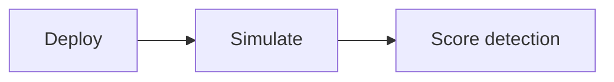

# Deploy Hub

**Route:** `/deploy` · **Sidebar:** Preparation → Deploy

The Deploy hub is the single front door for standing up a simulation environment. It presents a chooser split into two purposes, and every deployed environment **auto-registers as a simulation target** so it shows up in the [Campaign Designer](../simulation/campaign-designer.md).

## The three deployment paths

| Option | Purpose | Best for | Docs |
|--------|---------|----------|------|
| **Local Lab** | Stand up VirtualBox/Vagrant VMs on this host | Self-hosted installs, local evaluation | [Local Lab](local-lab.md) |
| **Cloud Lab** | Deploy Splunk Attack Range / GOAD into your own AWS/Azure/GCP account | SaaS / scalable per-tenant labs | [Cloud Lab](cloud-lab.md) |
| **Remote Fleet** | Install a signed agent on your own endpoints and run Atomic techniques | Adversary simulation against real endpoints | [Fleet Server](fleet-server.md) |

The chooser groups these as **Deploy a Lab** (Local Lab, Cloud Lab) and **Adversary Simulation** (Remote Fleet).

## The lifecycle

1. **Deploy** — pick a path and template; the hub reuses the existing cloud + local deploy machinery.
2. **Simulate** — the environment auto-registers as a target; run atomic tests or full campaigns against it.
3. **Score detection** — validation ties each run back to the detections that should have fired.

## How it works

- The page (`src/app/(dashboard)/deploy/page.tsx`) is a client chooser with a `view` state (`chooser` / `cloud` / `local` / `fleet`) that renders each flow inline.
- On load it calls `GET /api/deploy/capabilities` to decide whether **Local Lab** is available (`localAvailable`, gated on `PLATFORM_MODE=self-hosted`). When unavailable, the Local Lab card is disabled with a hint.
- Cloud embeds `CloudReadinessPanel` + `CloudTab` + `CloudRegisterPanel`; Fleet embeds the full Fleet console; Local embeds `LocalDeployFlow`.
- On successful deploy, `POST /api/deploy/register` records the environment so it becomes a selectable target.

## Where to go next

- To tear anything down safely, use [Manage Labs](manage-labs.md).
- For the raw/power-user console (blueprints, templates, VM control), see [Detection Lab (advanced)](../labs/local-lab.md#advanced-console) or the Preparation → Detection Lab page.
