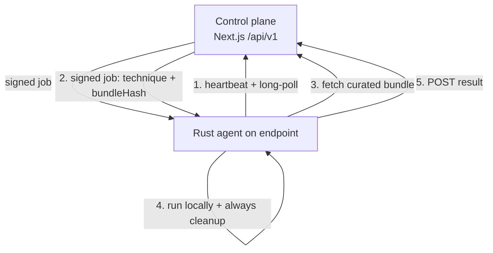

# Fleet Simulation (Remote Fleet)

**Route:** `/deploy` → **Remote Fleet** (the Fleet Simulation hub)

Fleet Simulation runs adversary techniques against **your own endpoints** and scores detection in real time. It offers two execution models:

1. **C2 servers** (recommended) — a lightweight in-memory **beacon** runs on the endpoint and a standalone **C2 server** (MITRE Caldera first; Sliver / OpenBAS planned) pushes TTPs over the channel. No bulk tooling is installed on the endpoint, no AV exclusions, and no per-run endpoint internet — so the endpoint's real defenses (EDR) are what you measure.
2. **Native agent fleet** — a signed Rust agent that polls out for curated, hash-pinned Atomic Red Team bundles and runs them locally.

Both appear together in the Fleet Simulation hub.

## Why C2, not "install ART on the endpoint"

Installing Atomic Red Team / PurpleSharp on each endpoint defeats the goal: pre-installed tooling + AV exclusions blind the very control you are testing, the install noise pollutes the detection baseline, it needs endpoint internet, and the binaries get quarantined by Defender. The C2-beacon model avoids all of that.

## C2 servers (Caldera)

**Two ways to get a Caldera C2**, decoupled from the Local-Lab Caldera:

- **Connect (bring-your-own):** point the platform at an existing Caldera REST URL + red API key.
- **Deploy (managed, self-hosted):** the platform clones + builds Caldera **natively** (Python venv + Go + the Vue UI) under `labs/deployments/<id>/` on the host, then start/stop it on demand.

!!! note "Managed Caldera is a native install, not Docker"
    Because Docker stores images on the (often full) root disk, the managed deploy runs Caldera from source on the big project disk. Prereqs on the host: Python ≥ 3.9, Go, Node.

### Start it on the right network

Managed Caldera does **not** auto-start. Click **Start…** and **choose the network interface** to advertise to your beacons (e.g. the VirtualBox host-only net `192.168.56.1`, not your Wi-Fi). Caldera binds `0.0.0.0`; the chosen address is what goes into the beacon enrollment one-liner and the console URL.

### The `/caldera` console

`/caldera` is a focused console for the local managed Caldera: **Start/Stop**, the **embedded Caldera UI** (Caldera sets no `X-Frame-Options`, so it frames in-page; "open in new tab" is the fallback), login credentials, and the **beacon enrollment one-liner** (Sandcat, pulled from the C2 over the LAN — no internet needed on the endpoint).

### Status reflects real liveness

The C2 status shown in the hub and `/caldera` is derived from a live TCP reachability probe, so a stopped or unreachable server reads **stopped/offline**, never a stale "running".

## Native agent fleet (existing)

Jobs are **ed25519-signed** and carry only addressing + a `bundleHash` (never a raw command); the agent re-hashes the served bundle (sha256) and refuses to run on a mismatch. Jobs are scope- and consent-gated and expire. Setup: create a fleet (name + allowed scope) → attach consent → mint an enrollment token → install the agent (`/api/v1/agent/download`) and enroll. Backends: `src/lib/bas/*`, agent routes under `/api/v1/*`, dashboard routes under `/api/fleets/*`, agent source in `bas-agent/`.

## Detection Lab (Splunk for the fleet)

The Fleet Simulation hub includes a **Detection Lab (Splunk + Windows)** panel that deploys the proven SAR-minimal lab — an Ubuntu **Splunk Enterprise** server plus a Windows host running the **Universal Forwarder + Sysmon** — so your fleet endpoints have a real Splunk to forward telemetry to and the platform can score detection in real time. It reuses the Local Lab deploy engine but adds **pre-deploy customization** (Splunk/Windows RAM + CPUs, network base, Splunk admin password) and deploys the VMs **under the project path** (`labs/deployments/<template>`). Splunk listens on `0.0.0.0`; keep the network base on a net your endpoints reach (e.g. your host-only `192.168.56`). On success, click **Use for fleet detection** to register it as the fleet's Splunk [SIEM connection](../detection/detection-validation.md#per-environment-siem-connections) — then run **Simulation & Detection** against a fleet/C2 target.

## Running from the Campaign Designer

Both C2 servers and native fleet nodes appear as selectable targets in the [Campaign Designer](../simulation/campaign-designer.md):

- **C2 target** ("C2 — *name*") → each technique maps to a Caldera ability run on the beacons (`/api/c2/[id]/run-technique`).
- **Remote Fleet target** → an atomic per technique queued on the node (`/api/fleets/{id}/nodes/{nodeId}/run-test`).

Both feed the same run→verdict display and the same [detection scoring](../detection/detection-validation.md). Every run is recorded in **Simulation History** tagged with its source (Local Lab / Cloud Lab / Remote Fleet / C2).

## Managing / removing

Under [Manage Labs → Remote Fleet](manage-labs.md):

- **C2 servers** — Delete (managed → tears the process down; connected → forgets it); the backing simulation target is removed either way.
- **Native fleet** — **Revoke a node** (stops just that agent on its next heartbeat) or **Delete a fleet** (cascade: every node stopped, plus tokens, campaigns, history).
