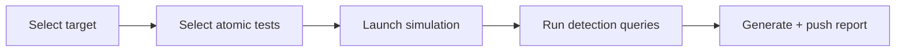

# Campaign Designer

**Route:** `/campaign-designer` · **Sidebar:** Simulation → Campaign Designer

The Campaign Designer is the end-to-end purple-team console. It ties together every target type, the atomic/detection catalogs, and reporting so you can go from "pick a server" to "did the detection fire?" in one place.

## What it does

1. **Pick a target.** The unified target list is grouped by source and shows only servers that are actually present and running:
    - **Local — SAR source install** (VMs from the local Splunk Attack Range)
    - **Local — <Deployed Lab>** (platform-managed Local Lab deployments)
    - **Cloud — <range>** (SAR ranges in your cloud)
    - **Remote Fleet — <fleet>** (enrolled agent endpoints)
    - **C2 — <server>** (Caldera C2 servers with online beacons)
2. **Choose techniques / tests.** Search the [Atomic Test Library](../content/atomic-test-library.md) and select the techniques to run.
3. **Launch the simulation.** Dispatch is routed by target source (see below).
4. **Run detection queries.** Execute the associated detections against the environment's [SIEM](../detection/detection-validation.md#per-environment-siem-connections) and see what fired.
5. **Report.** Produce a run report and optionally push it to GitHub — available in **both** "Just Simulation" and "Simulation & Detection" modes.

## Target-aware dispatch

Selecting a target routes the launch to the right backend:

| Target source | Launch path |
|---------------|-------------|
| Local / deployed lab (SAR) | `POST /api/sar/simulate` → Ansible/WinRM → `Invoke-AtomicTest`, polled via `/api/sar/simulations` |
| Cloud range | `POST /api/detection-lab/cloud/attack-range/simulate` (SAR controller), SSE terminal output |
| Remote Fleet node | `POST /api/fleets/{id}/nodes/{nodeId}/run-test` per technique; the agent runs it locally and the designer polls the node's test-runs |
| C2 server (Caldera) | `POST /api/c2/[id]/run-technique` per technique; the C2 runs the matching ability on its beacons over the channel |

!!! note "Live-state target list"
    Targets are cross-referenced against live VirtualBox state (`system-info.allVMs`) and live fleet/cloud state, so destroyed or offline servers don't appear. A server only shows once it is present and running.

## Data sources it pulls together

The page fetches SAR status, deployed labs (`/api/detection-lab/system-info`), cloud ranges (`/api/detection-lab/cloud/attack-range/list`), fleets (`/api/fleets`), the atomic catalog (`/api/atomic-tests`), community rules (`/api/community/...`), custom detections, and reporting (`/api/reports`).

## Typical workflow

## Detection SIEM (per environment)

In **Simulation & Detection** mode a "Detection SIEM" banner shows which SIEM this environment validates against, resolved automatically: Local → local Splunk (auto), Cloud → cloud Splunk, Fleet/C2 → your **MDE** (or BYO Splunk). Connect a Splunk or Microsoft Defender (MDE) SIEM inline — see [Detection Validation → Per-environment SIEM connections](../detection/detection-validation.md#per-environment-siem-connections). Detections run in real time (auto-retry ~100 s) via `POST /api/siem/[id]/detect`.

## Simulation History

Every run — **Local Lab, Cloud Lab, Remote Fleet, and C2** — is recorded under **Simulation History**, each row tagged with its **source** (Local Lab / Cloud Lab / Remote Fleet / C2 · Caldera). From a history row you can re-display the chain, resume/re-run, and **Save a report** (locally + optional GitHub push). Local SAR runs are recorded server-side; fleet/cloud/C2 runs are recorded via `POST /api/sar/simulations`.

For structured, repeatable validation with coverage scoring and multiple detection-logic variants, use [Enterprise Use-Case Validation](enterprise-use-cases.md) instead; the Campaign Designer is the free-form, exploratory console.
