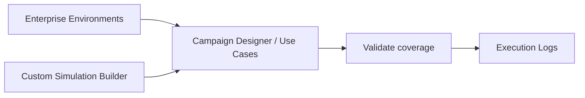

# Simulation

**Sidebar section:** Simulation

The Simulation section runs adversary behavior against your environments and validates whether your detections fire. It maps to the dashboard's **Simulation** menu.

## In this section

| Subsection | Route | What it does |
|-----------|-------|--------------|
| [Campaign Designer](campaign-designer.md) | `/campaign-designer` | End-to-end purple-team console across local/cloud/fleet targets. |
| [Enterprise Environments](enterprise-environments.md) | `/detections/enterprise/environments` | Manage the targets scenarios run against. |
| [Enterprise Use Cases](enterprise-use-cases.md) | `/detections/enterprise` | Repeatable, **scored** validation (simulate + validate coverage). |
| [Custom Simulation Builder](custom-simulation-builder.md) | `/use-cases` | Build your own use cases (ART YAML / PurpleSharp / visual canvas). |
| [Updating a Library](updating-libraries.md) | `/marketplace/build` | Add a newly discovered technique to an existing library as an atomic-style YAML entry. |
| [Replay Catalog](replay-catalog.md) | `/replay-catalog` | Replay pre-recorded attack datasets into Splunk via HEC. |
| [Build Forge](build-forge.md) | `/build-forge` | Discover, build, and collect attacker tooling. |
| [Execution Logs](execution-logs.md) | `/execution-logs` | History of simulation runs. |

## The loop

For the underlying execution transports (SSH, native fleet agent, Caldera, Stratus, Ansible/WinRM), see [Architecture](../getting-started/architecture.md).
