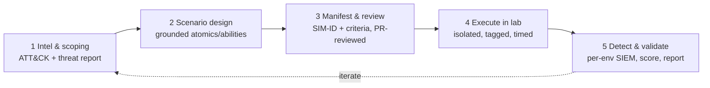

# Attack Simulation Framework

A production-grade framework for designing, running, and validating realistic attack simulations across DetectOps labs. It is **grounded in the platform as it exists today** — the `SimulationRun` model, per-environment `SiemConnection`, Atomic Red Team content, per-lab networks, and the Campaign Designer detection loop — and calls out the few additions needed to reach full traceability.

!!! principle "Non-negotiables"
    - **Realism over speculation.** Every scenario maps to documented adversary behavior — a MITRE ATT&CK technique with real procedure examples, an Atomic Red Team test, or a verified threat/CVE report. No invented TTPs, no fabricated telemetry.
    - **Traceable.** Every run is tied to a stable simulation ID, a lab, ATT&CK technique(s), and time-synced evidence.
    - **Isolated.** One lab's activity never contaminates another (separate network, SIEM index, deploy path).
    - **Honest data.** Displayed alerts/logs/metrics reflect what actually happened; anything synthesized for demo is labeled.

---

## 1. Design approach — the simulation lifecycle

Each simulation moves through five gated stages. The gate between stages is what keeps it grounded and repeatable.



1. **Intel & scoping.** Start from a real signal — a threat report, a CVE, a ransomware-gang TTP (the platform's threat-intel aggregator + ransomware-intel module), or a coverage gap on the ATT&CK map. Output: the technique(s) to exercise and the target lab.
2. **Scenario design.** Bind the technique to **documented, runnable content only**: an Atomic Red Team test (the ~2,000-test library, each MITRE-mapped with `auto_generated_guid`), a Caldera ability (Fleet), or a Module Marketplace scenario. If no grounded content exists, the scenario is *not built* — it is filed as a content gap, never faked.
3. **Manifest & review.** Author a **simulation manifest** (below) with the SIM-ID, metadata, expected detection signals, and success/failure criteria. Manifests live in the repo (`simulations/`) and are **PR-reviewed** — detection-as-code discipline for offense-as-code.
4. **Execute in lab.** Run through the Campaign Designer or the `detectops` CLI against exactly one lab. The run is tagged with the SIM-ID, host, and a UTC time window.
5. **Detect & validate.** The per-environment SIEM is queried in real time (Splunk SPL / Microsoft Defender KQL), scored against the manifest's expected signals, and written to a report tied to the SIM-ID.

**Maintainability & CI/CD.** Manifests are versioned in git; a scheduled or PR-triggered job runs the suite headlessly via the CLI, so simulations are repeatable regression tests for detections — not one-off clicks.

---

## 2. Naming & ID scheme

### 2.1 Scenario identity (stable)

```
SIM-<LAB>-<SCENARIO>-v<N>
```

| Segment | Meaning | Examples |
|---------|---------|----------|
| `LAB` | Stable **environment class** code — never the ephemeral deploy id | `LOCLAB`, `FLEET`, `CLOUDAWS` |
| `SCENARIO` | Stable scenario slug, usually `<name>_<technique>` | `MSHTA_T1218_011`, `RANSOM_EXEC_T1486` |
| `vN` | Scenario **version**; bump when the manifest's behavior/criteria change | `v1`, `v2` |

**Example:** `SIM-LOCLAB-MSHTA_T1218_011-v1`

> The `LAB` code is an environment *class*, decoupled from the throwaway deploy prefix (`lab-ob36ng-…`). A re-deployed lab keeps the same `LAB` code, so history stays comparable across rebuilds.

### 2.2 Run identity (per execution)

Each execution is one `SimulationRun` row. Its `id` (uuid) is the **run instance**; the SIM-ID is the **scenario**. Compose the two for a fully-qualified reference:

```
SIM-LOCLAB-MSHTA_T1218_011-v1 @ 2026-09-16T10:22:04Z  (run 7f3c…e91)
```

### 2.3 How it's tracked (one platform change)

`SimulationRun` today has no stable scenario field. **Add `simId String? @default("")`** (and an index) to `model SimulationRun` so every run persists its scenario identity next to the existing `techniqueIds`, `source`, `status`, `detectionResults`, `validationCompletedAt`. Then:

- The **manifest** (`simulations/SIM-LOCLAB-MSHTA_T1218_011-v1.yml`) is the source of truth for the scenario.
- The **`SimulationRun` row** records the execution and links back via `simId`.
- The **event-log** (`logEvent`) and **DetectionReport** carry the SIM-ID so audit trail, telemetry, and reports all correlate.

No other model changes are required — `source`, `targetServer`, `executionMode`, `selectedDetections`, `detectionResults` already give per-run traceability.

---

## 3. Per-lab simulation environments

Every lab is an **isolated** blast-radius with its own telemetry and SIEM. The platform already provides three classes:

| Lab class (`LAB` code) | Substrate | Network isolation | SIEM |
|------------------------|-----------|-------------------|------|
| `LOCLAB` | SAR (+GOAD) on VirtualBox/Vagrant | Private VBox network per deploy (`10.0.1.0/24` or a chosen `192.168.56.x`) | Local Splunk (auto-provisioned from `attack_range_local.conf`) |
| `FLEET` | Native agent + Caldera C2 + Splunk detection lab | Host-only net chosen at deploy so Caldera + lab share a subnet | Fleet Splunk (or Microsoft Defender BYO-key) |
| `CLOUDAWS/AZURE/GCP` | SAR range in your own cloud tenant | Per-range VPC/VNet + WireGuard | Cloud-scoped Splunk |

**Isolation controls (enforced, not assumed):**

- **Network.** Each deploy runs on its own subnet; the network base is chosen before deploy and written into the lab's conf. Detection queries and forwarders target that lab's real IP — never a shared default. (This is why displayed IPs must reflect the deployed `networkBase`, not the `10.0.1.x` template default.)
- **SIEM.** Each environment binds to its **own** `SiemConnection` (encrypted, per-scope: local/cloud/fleet). A run only ever queries the SIEM of the lab it ran in → no cross-lab contamination of detection results.
- **Deploy path.** Each lab has a distinct deploy directory + VM name prefix (`lab-<id>-*`), so lifecycle actions and creds resolve to exactly one lab.

**Real-time detection + telemetry.** Endpoints ship Sysmon / Windows Event Log / PowerShell logs through a Universal Forwarder (`:9997`) into `index=win`; the platform queries Splunk REST (`:8089`, SPL) — or Defender Graph Advanced Hunting (KQL) — in a **bounded, non-overlapping validation loop** (re-check undetected rules every 5 s, up to ~10 checks, then stop). This gives real-time verdicts without hammering the SIEM.

**Safe execution.** Use the platform's guardrails: atomic per-test timeouts (bounded so a hung LOLBAS test can't stall the batch), `-Cleanup` after every technique, VM snapshots before a destructive scenario, and the approval-gated / kill-switch modules for offensive-leaning content (phishing, ransomware TTPs). Nothing runs outside a lab you explicitly targeted.

---

## 4. Data accuracy & integrity

Every displayed artifact must be **correct, time-synced, and attributed to the right SIM-ID + lab**. Controls:

1. **Correlation window, not guesswork.** Scope every detection query to the run's **exact time window** (`[startedAt − Δ, completedAt + Δ]`) **and** the run's target **host**, plus (where possible) a per-run marker. The detection result is derived only from real SIEM query hits (`resultCount` from the returned rows) — never inferred.
2. **Time sync.** All lab hosts, the SIEM, and the controller run NTP; timestamps are stored and compared in **UTC**. A run's `startedAt`/`completedAt` bound the search window so a later run's telemetry can't be mis-attributed to an earlier one.
3. **Attribution on every artifact.** Logs, alerts, detection rows, and report sections all carry `{ simId, runId, lab, host, technique, timestampUTC }`. Reports are assembled **only** from that run's `SimulationRun.detectionResults` — not from a shared global query.
4. **No fabrication.** Detection verdicts come from actual SIEM results. If a value is approximated or synthesized for a demo (e.g., a placeholder dashboard), it is explicitly labeled `synthetic: true` and visually marked — never presented as a real outcome.
5. **Isolation guarantees accuracy.** Because each lab has its own network + SIEM + index, a query for lab A physically cannot return lab B's events.
6. **Auditability.** Every stage emits an `event-log` entry (actor, action, status, durationMs, SIM-ID) so a run is reconstructable end-to-end for debugging.

---

## 5. Worked example — end to end

A concrete, fully-grounded scenario. **T1218.011 (System Binary Proxy Execution: Mshta)** is a real, MITRE-documented LOLBAS technique with published procedure examples across multiple actors; the platform has documented Atomic Red Team tests for it (16 tests, each with a stable GUID).

### 5.1 Manifest — `simulations/SIM-LOCLAB-MSHTA_T1218_011-v1.yml`

```yaml
sim_id: SIM-LOCLAB-MSHTA_T1218_011-v1
title: "Mshta signed-binary proxy execution (local SAR lab)"
version: 1
status: active

target:
  lab: LOCLAB                       # SAR Minimal on VirtualBox
  host: windows-dc                  # resolves to lab-<id>-windows-dc
  network_base: 192.168.56          # chosen at deploy; queries use the real IP

attack:
  tactic: TA0005 (Defense Evasion)
  techniques: [T1218.011]
  source: atomic-red-team           # documented content, not invented
  # Pin exact tests for repeatability; omit to run the full technique.
  atomic_guids:
    - "a316a2e9-...-mshta-vbscript"  # (fill from the T1218.011.yaml)
  threat_context: >
    Mshta.exe abused as a signed proxy to execute remote/inline HTA/VBScript.
    Documented in MITRE ATT&CK T1218.011 procedure examples (multiple actors).

expected_signals:
  - source: sysmon
    event: "Process Create (EID 1) — Image ends with \\mshta.exe"
    index: win
  - source: detection
    rule: "ESCU/Sigma: suspicious mshta.exe execution"
    engine: splunk_spl               # sysmon pipeline → EventID=1 Image="*\\mshta.exe"

success_criteria:
  simulation: "All selected atomic tests execute (win_shell returns, cleanup runs)."
  detection: ">=1 expected signal fires within the validation window (~50s)."
coverage_goal: "T1218.011 marked detected on the ATT&CK coverage map."
```

### 5.2 Execution

- **Campaign Designer:** target `LOCLAB` → `windows-dc`, technique `T1218.011`, mode *Simulation & Detection*. Or headless:
  ```bash
  detectops local start --name "SAR Minimal"      # ensure the lab is up
  # (run the technique via Campaign Designer / the sim runner)
  ```
- A `SimulationRun` row is created with `simId=SIM-LOCLAB-MSHTA_T1218_011-v1`, `source=local`, `executor=art`, `techniqueIds=["T1218.011"]`, `targetServer=lab-<id>-windows-dc`, `executionMode=simulation_detection`, `startedAt` (UTC).

### 5.3 Detection & validation

- Endpoint runs the atomics → Sysmon EID 1 for `mshta.exe` → `index=win`.
- The per-env Splunk SIEM is queried with the ESCU/Sigma rule (`sysmon` pipeline yields `EventID=1 Image="*\\mshta.exe"`), scoped to the run's host + `[startedAt, completedAt]` window, in the bounded 5 s × ~10 retry loop.
- Results land in `SimulationRun.detectionResults` with `matchCount`, `strategies`, and sample events; `validationCompletedAt` is set.

### 5.4 Expected outcome

| Dimension | Expected |
|-----------|----------|
| Simulation status | `success` — all tests executed, cleanup ran (per-test 60 s cap; batch fits the Ansible timeout) |
| Detection | `detected` — ≥1 Sysmon EID 1 mshta event + rule fires within ~50 s |
| Coverage | `T1218.011` flips to *covered/validated* on the ATT&CK map |
| Report | Local-first markdown → GitHub PR, carrying `SIM-LOCLAB-MSHTA_T1218_011-v1`, the run id, host, UTC window, and the exact SPL + hit count |
| If **not detected** | A grounded gap: telemetry present but no rule → author/tune a Sigma rule in the Rule Workspace → new detection → re-run the same SIM-ID to confirm the fix |

---

## 6. Adoption roadmap (mapped to the platform)

| Step | Status | Where |
|------|--------|-------|
| Per-lab isolation (network / SIEM / deploy path) | **Exists** | Deploy engine, `SiemConnection`, system-info |
| Real-time, bounded detection validation | **Exists** | Campaign Designer detection loop |
| Grounded content (ART / Caldera / packs, MITRE-mapped) | **Exists** | Atomic Test Library, Detection Packs, threat aggregator |
| Per-run audit + reports | **Exists** | `event-log`, `DetectionReport`, GitHub push |
| **Stable `simId` on `SimulationRun`** | **Add** | `prisma/schema.prisma` (+ index), thread through the runner + reports |
| **Versioned manifests in git (`simulations/`)** | **Add** | New dir + a small loader; PR-reviewed |
| **Headless suite runner in CI** | **Add** | Extend the `detectops` CLI with a `sim` subcommand driving manifests |

The first three rows are already how the platform behaves; the last three make it a **repeatable, traceable, CI-integrated** framework rather than ad-hoc runs.
