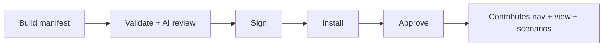

# Module Marketplace

**Route:** `/marketplace` · **Sidebar:** Preparation → Module Marketplace

A plugin architecture where **declarative simulation modules** compile down to the platform's `ScenarioStep[]` runner. The marketplace lets you browse, build, validate, sign, install, and approve modules that contribute new simulation categories.

## Pages

- **Browse** (`/marketplace`) — search/filter installable modules; kicks the validation worker.
- **Build** (`/marketplace/build`) — the Module Builder, with two tabs: **New module** (author a whole manifest) and **Add technique to a library** (add one newly discovered technique to an *existing* library as an atomic-style YAML entry, merged into that library without editing it — see [Updating a Library](../simulation/updating-libraries.md)).
- **Detail** (`/marketplace/[moduleId]`) — module info, versions, install/approve.

## Lifecycle

Once approved, a module contributes a sidebar nav entry (via `/api/modules/nav`), a rich view at `/modules/{moduleId}`, and runnable scenarios. First-party seeded modules (LOTL, Phishing, Ransomware) are described in [Attack Simulations](../simulation/attack-simulations.md).

## Module system

`src/lib/modules/`: `registry.ts`, `compiler.ts`, `materialize.ts`, `manifest-schema.ts` (`ModuleManifest`), `signing.ts`, `package-store.ts`, `deps.ts`/`semver.ts`, and `validation/` (`checks.ts`, `ai-review.ts`, `worker.ts`). A module's declarative steps are compiled to `ScenarioStep[]` and executed by the same runner as everything else.

## APIs

`/api/modules` (list/create), `/api/modules/template`, `/api/modules/validate`, `/api/modules/validation/tick`, `/api/modules/[moduleId]` (+ `/install`, `/approve`, `/run`, `/versions`, `/scenarios`), `/api/modules/nav`.

## Feature flags

`ENABLE_MODULE_MARKETPLACE`, `ENABLE_MODULE_AUTO_APPROVE`, `ENABLE_MODULE_SIGNING` — see [Configuration](../getting-started/configuration.md).
